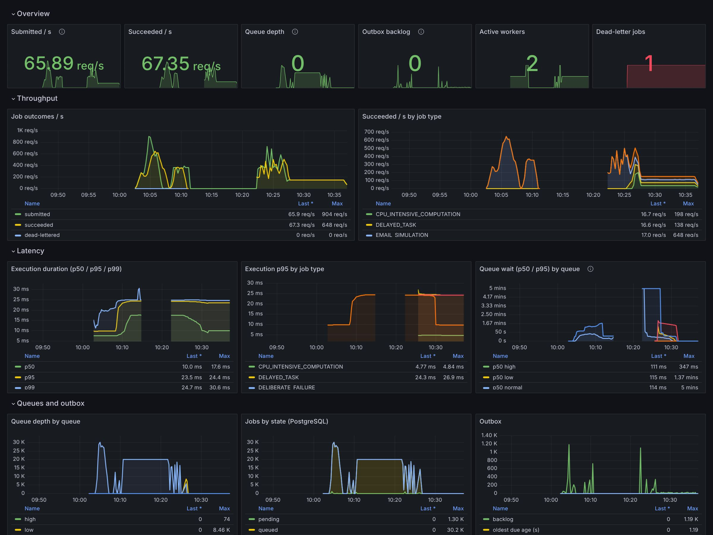
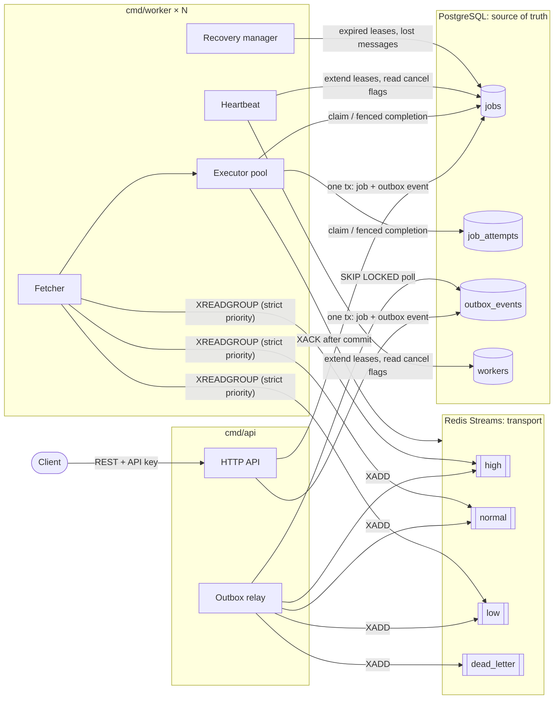

# EventFlow

**A fault-tolerant, observable, distributed asynchronous job processing platform written in Go.**

Clients submit background jobs over a REST API. Jobs are persisted in
PostgreSQL, announced through a **transactional outbox** to **Redis Streams**,
and executed by horizontally scalable **worker pools**. The workers use
lease-based ownership, heartbeats, fenced writes, automatic retries with
exponential backoff and jitter, a dead-letter queue, and crash recovery.
Everything is instrumented with Prometheus metrics, structured JSON logs and
a provisioned Grafana dashboard.



---

## Contents

- [Features](#features)
- [Architecture](#architecture)
- [Technology stack](#technology-stack)
- [Quick start](#quick-start)
- [API at a glance](#api-at-a-glance)
- [Key design decisions](#key-design-decisions)
- [Database design](#database-design)
- [Delivery guarantees and the idempotency contract](#delivery-guarantees-and-the-idempotency-contract)
- [Observability](#observability)
- [Testing](#testing)
- [Performance](#performance)
- [Project layout](#project-layout)
- [Known limitations](#known-limitations)
- [Future improvements](#future-improvements)

## Features

| Area | What is implemented |
|------|---------------------|
| Submission | Versioned REST API, strict JSON validation (unknown fields rejected), per-handler payload validation, payload and body size limits |
| Idempotency | `Idempotency-Key` header or field, scoped per API key; replays return the original job, mismatched reuse returns `409`; safe under concurrent duplicates |
| Scheduling | Priorities 1–10 mapped to `high`/`normal`/`low` streams with strict-priority consumption; delayed (`delay_seconds`) and scheduled (`scheduled_at`) execution |
| Reliability | Transactional outbox, at-least-once delivery, ack only after the outcome is durable, duplicate-delivery suppression, stale-message claiming (`XAUTOCLAIM`) |
| Workers | Configurable goroutine pool, back-pressure, per-job timeouts, context cancellation, heartbeats, leases with fencing tokens, self-fencing, graceful shutdown |
| Failure handling | Exponential backoff with jitter, error classification (retryable vs permanent, timeout, panic, …), dead-letter queue (DB + Redis stream), manual retry |
| Recovery | Expired-lease recovery after worker crashes, re-publication of messages lost by Redis, dead-worker detection, safe stream trimming |
| Cancellation | Immediate for pending/queued jobs; cooperative for running jobs, with a race-free outcome against completion |
| History | Every attempt recorded: worker, timings, duration, error, error class |
| Security | Hashed, revocable API keys; env-based secrets; least-privilege DB role; non-root distroless read-only containers; no secret logging |
| Observability | Prometheus metrics (bounded cardinality), JSON logs with request IDs, Grafana dashboard, alert rules, health/readiness probes |
| Delivery | Docker Compose stack, multi-stage Dockerfile, Makefile, OpenAPI 3.0 spec, k6 load tests, GitHub Actions CI |

## Architecture



**Lifecycle**: `pending → queued → running → succeeded | failed (dead-lettered) | cancelled`.
A retryable failure moves the job back to `pending` with a delayed outbox
event. Failed and cancelled jobs can be retried manually.

The full design, with sequence diagrams for submission, relay and execution,
the state machine, the failure-mode matrix and the rationale for each
decision, is in **[docs/architecture.md](docs/architecture.md)**.

## Technology stack

| | |
|---|---|
| Language | Go 1.26 (stdlib `net/http` routing, `log/slog`) |
| Database | PostgreSQL 16 via `pgx/v5` (pooling) |
| Broker | Redis 7.2 Streams via `go-redis/v9` (consumer groups) |
| Metrics / dashboards | Prometheus client, Prometheus 2.54, Grafana 11.2 |
| Testing | Go testing, Testcontainers-go (real PostgreSQL and Redis), race detector |
| Load testing | k6 |
| Packaging | Docker multi-stage builds (distroless), Docker Compose |
| Cloud | Terraform modules for AWS EC2 and GCP Compute Engine (single-VM demo deployment) |
| CI | GitHub Actions (lint, vet, golangci-lint, govulncheck, unit, integration, Compose smoke test) |

Direct dependencies are deliberately few: `pgx`, `go-redis`,
`prometheus/client_golang`, `google/uuid`, and `testcontainers-go` for tests.

## Quick start

Requirements: Docker with Compose v2, GNU Make, `openssl`, and `jq` for the smoke test.

```bash
git clone https://github.com/abhinav0107-colllab/eventflow.git && cd eventflow
make env      # writes .env with random secrets (gitignored); or copy .env.example and fill it in
make up       # builds images, runs migrations, starts API, 2 workers, Prometheus, Grafana
make smoke    # submits one job of each type and waits for the expected outcome
```

| Service | URL |
|---------|-----|
| API | http://localhost:8080 (OpenAPI at `/openapi.yaml`) |
| Grafana | http://localhost:3000 (user `admin`, password `GRAFANA_ADMIN_PASSWORD` from `.env`) |
| Prometheus | http://localhost:9090 |

Scale workers with `docker compose up -d --scale worker=4`. Stop with
`make down`. `make clean-stack` also **deletes** the data volumes.

To run the binaries without Docker, see [docs/operations.md](docs/operations.md#running).

### Deploy to AWS or GCP

Terraform modules in `deploy/terraform/aws` and `deploy/terraform/gcp`
provision a free-tier-sized VM that runs the same stack. Only SSH and the API
are exposed, and only to your IP; secrets are generated on the VM. Step-by-step
guide (Windows PowerShell commands included): **[docs/deployment.md](docs/deployment.md)**.

## API at a glance

| Method | Path | Purpose |
|--------|------|---------|
| `POST` | `/api/v1/jobs` | Submit a job (`201`, or `200` on idempotent replay) |
| `GET` | `/api/v1/jobs` | List with filters (`status`, `type`, `queue`, `dead_lettered`, date range) and cursor pagination |
| `GET` | `/api/v1/jobs/{id}` | Job details, including result and last error |
| `POST` | `/api/v1/jobs/{id}/cancel` | Cancel (`200` immediate, `202` running, `409` terminal) |
| `POST` | `/api/v1/jobs/{id}/retry` | Manually retry a failed or cancelled job |
| `GET` | `/api/v1/jobs/{id}/attempts` | Execution history |
| `GET` | `/api/v1/queues` | Stream, DLQ, outbox and worker statistics |
| `GET` | `/api/v1/workers`, `/api/v1/job-types` | Registered workers and handler types |
| `GET` | `/health`, `/ready`, `/metrics`, `/openapi.yaml` | Probes, metrics, spec (unauthenticated) |

```bash
KEY=$(grep ^EVENTFLOW_API_KEYS .env | cut -d= -f2 | cut -d, -f1)

curl -s -X POST localhost:8080/api/v1/jobs -H "X-API-Key: $KEY" -H 'Idempotency-Key: welcome-42' \
  -d '{"type":"EMAIL_SIMULATION","payload":{"to":"user@example.com","subject":"Welcome"},"priority":8}'

curl -s -X POST localhost:8080/api/v1/jobs -H "X-API-Key: $KEY" \
  -d '{"type":"DELIBERATE_FAILURE","payload":{"mode":"until_attempt","succeed_on_attempt":3},"max_attempts":5}'

curl -s "localhost:8080/api/v1/jobs?dead_lettered=true" -H "X-API-Key: $KEY"
```

Built-in job types never touch the network: `EMAIL_SIMULATION`,
`WEBHOOK_SIMULATION` (the simulated status code drives retry vs permanent
failure), `CPU_INTENSIVE_COMPUTATION` (real prime sieve or SHA-256 chain),
`DELIBERATE_FAILURE` (`always`, `until_attempt`, `permanent`, `panic`) and
`DELAYED_TASK`. More examples are in **[docs/api.md](docs/api.md)**. The
contract is **[api/openapi.yaml](api/openapi.yaml)**.

## Key design decisions

1. **PostgreSQL is authoritative; Redis is only a hint.** A message just says
   "job X may be ready". Workers always claim through a conditional update in
   PostgreSQL, so duplicate, stale or lost messages can never corrupt state.
2. **Transactional outbox.** The job row and its `job.ready` event commit in
   one transaction. The relay marks a job `queued` only in the transaction
   that observed `XADD` succeed. The same mechanism schedules delayed jobs and
   retries (an outbox row with a future `available_at`) and routes dead
   letters.
3. **Leases with fencing tokens.** Claiming increments `attempts`, and every
   later write is conditional on `(status='running', worker_id, attempts)`. A
   worker whose lease expired cannot overwrite the state of the attempt that
   replaced it.
4. **Ack after commit.** XACK happens only after the outcome is durable. A
   crash in between leaves the message pending; it is re-claimed and then
   dropped as a duplicate.
5. **Recovery is data-driven and idempotent.** Expired leases, lost messages
   and dead workers are detected from PostgreSQL state and repaired with
   `SKIP LOCKED`, so every worker can run recovery safely.
6. **A race found by tests.** A plain `UPDATE … WHERE status='queued'` loses
   messages under READ COMMITTED when a worker races the relay's commit. The
   claim locks the row first. The bug and its fix are documented in
   `Store.Claim` and in the architecture doc.

## Database design

Five tables: `jobs`, `job_attempts`, `outbox_events`, `workers`,
`api_keys`. All have CHECK constraints for valid states. There is a partial
unique index for idempotency keys, keyset-pagination indexes, and partial
indexes for every background scan (running leases, queued jobs, pending
outbox events). Migrations are embedded, reversible (`migrate down N`) and
serialized with an advisory lock. The API and workers connect as a
DML-only role. The ER diagram and index rationale are in
[docs/architecture.md](docs/architecture.md#database-design).

## Delivery guarantees and the idempotency contract

* **At-least-once execution.** A job runs again only if the previous
  attempt's outcome was not durably recorded (crash, lease expiry, shutdown
  interruption).
* **Exactly-once state transitions.** At most one attempt can record success
  (fenced writes), and duplicate messages never start a second concurrent
  execution.
* **Not exactly-once side effects.** Handlers receive a stable
  `IdempotencyKey` (the job ID) and must use it to deduplicate external
  effects, for example as an `Idempotency-Key` header or in a unique
  constraint. This is a fundamental limit of any system that calls external
  services. See
  [the full contract](docs/architecture.md#idempotency-contract-and-the-limits-of-exactly-once).

## Observability

| Metric | Type | Labels |
|--------|------|--------|
| `eventflow_jobs_submitted_total` | counter | `type` |
| `eventflow_jobs_succeeded_total` / `_retried_total` / `_dead_lettered_total` / `_cancelled_total` | counter | `type` |
| `eventflow_job_attempt_failures_total` | counter | `type`, `class` |
| `eventflow_job_execution_duration_seconds` | histogram | `type`, `outcome` |
| `eventflow_job_queue_wait_seconds` | histogram | `queue` |
| `eventflow_queue_depth`, `eventflow_queue_pending_messages` | gauge | `queue` |
| `eventflow_jobs_in_state`, `eventflow_dead_letter_jobs` | gauge | `queue`, `status` |
| `eventflow_outbox_backlog`, `eventflow_outbox_oldest_due_age_seconds` | gauge | – |
| `eventflow_outbox_published_total`, `eventflow_outbox_publish_errors_total`, `eventflow_outbox_publish_delay_seconds` | counter / histogram | `event_type` |
| `eventflow_active_workers`, `eventflow_worker_inflight_jobs`, `eventflow_worker_concurrency` | gauge | – |
| `eventflow_worker_failures_total` | counter | `reason` (`broker`, `database`, `heartbeat`, `lease_lost`, `ack`, `recovery`) |
| `eventflow_recovered_jobs_total`, `eventflow_duplicate_deliveries_total` | counter | `reason` |
| `eventflow_http_requests_total`, `eventflow_http_request_duration_seconds` | counter / histogram | `method`, `route` (pattern), `code` |

* **Grafana**: the provisioned *EventFlow* dashboard (home page) has 25
  panels: throughput, outcomes, latency percentiles, queue wait, queue depth,
  jobs by state, outbox health, worker utilisation, failures by class,
  recovery activity and HTTP RED metrics.
* **Alerts** (`monitoring/prometheus/alerts.yml`): no active workers, stalled
  outbox, dead-letter growth, backlog, attempt failure rate, and worker
  infrastructure errors.
* **Logs**: JSON. Every request logs `request_id`, route, status and
  latency. Job events carry `job_id`, `job_type`, `attempt` and `worker_id`.
* **Probes**: `/health` (liveness) and `/ready` (PostgreSQL + Redis, and 503
  while draining) on the API. Workers expose the same probes on `:9091`.

## Testing

```bash
make test               # unit tests, race detector
make test-integration   # integration + failure tests (Docker required)
make lint               # gofmt, go vet, golangci-lint
```

**Unit tests** cover the state machine (exhaustive transition table),
backoff bounds and jitter, error classification, request validation,
idempotency fingerprints, cursors, every handler (validation, timeouts,
cancellation), configuration validation, middleware (auth, request IDs,
panic recovery, body limits, route-pattern metrics) and API rejection
paths.

**Integration tests** (`tests/integration`, build tag `integration`) run the
real API, relay, workers and recovery against **real PostgreSQL 16 and Redis
7.2 containers** started by Testcontainers. Nothing is mocked:

| Scenario | Test |
|----------|------|
| Migrations up → down → up | `TestMigrationsRollBackAndReapply` |
| Job + outbox event written atomically | `TestCreateJobPersistsJobAndOutboxEventAtomically` |
| Idempotent replay, conflict, per-key scoping | `TestIdempotencyKeys` |
| 40 concurrent identical submissions create exactly one job | `TestConcurrentIdempotentSubmissionsCreateOneJob` |
| 300 concurrent submissions | `TestConcurrentSubmissions` |
| Relay publishes and marks queued; delayed jobs wait | `TestRelayPublishesAndMarksJobsQueued`, `TestDelayedJobIsPublishedOnlyWhenDue` |
| All job types on two workers; strict priority | `TestWorkersExecuteAllJobTypes`, `TestStrictPriorityOrdering` |
| Backoff-spaced retries; DLQ; manual retry | `TestRetryWithBackoffThenSuccess`, `TestDeadLetterAndManualRetry` |
| Permanent errors, panics, timeouts | `TestPermanentFailureAndPanicHandling`, `TestExecutionTimeout` |
| Duplicate and poison messages | `TestDuplicateDeliveriesExecuteOnce` |
| Cancellation; cancel vs complete races | `TestCancellation`, `TestConcurrentCancelAndCompletion` |
| **SIGKILL a real worker process mid-job** | `TestWorkerCrashRecovery` |
| SIGTERM a real worker process, then restart it | `TestWorkerProcessGracefulShutdownAndRestart` |
| Shutdown timeout interrupts and reschedules | `TestShutdownTimeoutInterruptsAndReschedules` |
| Expired leases fence stale workers | `TestExpiredLeaseFencesStaleWorker`, `TestLeaseLossStopsRunningHandler` |
| **Redis outage** (TCP fault proxy) for the relay, worker and readiness | `TestRelaySurvivesRedisOutage`, `TestWorkerSurvivesRedisInterruption`, `TestReadinessReportsRedisOutage` |
| **PostgreSQL outage** during execution | `TestDatabaseOutageDuringExecution` |
| Redis data loss: lost messages re-published | `TestLostBrokerMessagesAreRepublished` |
| Stream trimming never drops unacked work | `TestStreamTrimKeepsUndeliveredAndUnacked` |

Latest local run: all **43 unit tests** (6 packages) and all **32 integration tests**
pass, including under `-race`. The integration suite passed 4 of 4 full runs
(one under `-race`, one under coverage) with no flakes. Merged unit + integration coverage of `internal/...` is **82.8%**
([test execution record](docs/performance.md#test-execution-record)).

## Performance

Measured with k6 against the full Docker Compose stack on a single **4-vCPU
(Intel Xeon 2.1 GHz) / 15 GB** cloud VM. PostgreSQL, Redis, the API, two
workers, Prometheus, Grafana *and* the k6 load generator all share those 4
vCPUs, so treat the numbers as a lower bound.

| Scenario | Throughput | p50 | p95 | p99 | Errors |
|----------|-----------:|----:|----:|----:|-------:|
| Job submission, 300 req/s target | 300 req/s | 2.5 ms | 23.6 ms | 64.2 ms | 0 % |
| Job submission, 600 req/s target | 599 req/s | 17.4 ms | 64.0 ms | 107.1 ms | 0 % |
| Job submission, 1000 req/s target (saturated) | 984 req/s | 105 ms | 310 ms | 444 ms | 0 % |
| Reads, 1000 req/s: `GET /jobs/{id}` | 998 req/s total | 0.8 ms | 1.8 ms | 5.6 ms | 0 % |
| Reads, 1000 req/s: `GET /jobs` (list) | (same run) | 1.8 ms | 4.1 ms | 10.0 ms | 0 % |
| 100 concurrent VUs (submit + get + list) | 1656 req/s | 41 ms | 116 ms | 164 ms | 0 % |
| End-to-end submit + process, 20k jobs | **494 jobs/s** | – | – | – | 0 % |
| Sustained 10 min, 150 writes/s + 150 reads/s | 300 req/s | 2.1 ms | 7.2 ms | 17.9 ms | 0 % |
| Pure worker drain, 20k queued jobs: 1 worker × 16 / 2 × 16 / 1 × 64 | **495 / 910 / 1190 jobs/s** | – | – | – | – |

Methodology, every run (including the read test that ran while workers were
still busy, which had a p95 of 440 ms), the sustained-load results and the
bottleneck analysis are in **[docs/performance.md](docs/performance.md)**.

## Project layout

```
api/openapi.yaml          OpenAPI 3.0 spec (embedded and served at /openapi.yaml)
cmd/api                   API server + outbox relay + stats collector
cmd/worker                worker pool + recovery manager + metrics server
cmd/migrate               up / down N / status
cmd/healthcheck           tiny probe binary for distroless HEALTHCHECKs
internal/api              HTTP handlers, routing, queue statistics
internal/auth             hashed API key store
internal/broker           Redis Streams (groups, priority reads, claim, trim, stats)
internal/config           env configuration + validation
internal/database         pgx pool, transactions, migration runner
internal/jobs             domain model, state machine, backoff, errors, store (SQL)
internal/jobs/handlers    example job handlers
internal/middleware       request IDs, logging, metrics, recovery, auth, limits
internal/observability    slog JSON logger, Prometheus metrics
internal/outbox           outbox insertion + relay
internal/worker           worker engine, registry, recovery manager
migrations/               versioned SQL (embedded)
deploy/                   Dockerfile, PostgreSQL role bootstrap, cloud bootstrap, Terraform (AWS, GCP)
monitoring/               Prometheus config + alerts, Grafana provisioning + dashboard
loadtest/                 k6 scripts (results/ is gitignored)
scripts/                  smoke test, drain benchmark, dashboard generator
tests/integration/        Testcontainers integration + failure tests
docs/                     architecture, API guide, operations, performance, cloud deployment
```

## Known limitations

* **Strict priority can starve** the `low` queue under sustained high-priority
  load. This is by design; weighted scheduling is future work.
* **Side effects are at-least-once.** Exactly-once external effects require
  idempotent handlers (see the contract above).
* **Running-job cancellation is cooperative** and is observed at the next
  heartbeat (default 10 s). A handler that ignores its context runs until
  its timeout.
* **Single PostgreSQL primary.** It is the throughput ceiling for state
  transitions (about 3 commits per job). There is no sharding or partitioning
  yet, and old jobs are not archived automatically. Outbox rows are pruned
  after `OUTBOX_RETENTION`.
* **The outbox relay polls** (200 ms when idle) rather than using
  `LISTEN/NOTIFY`, which adds up to one poll interval of pickup latency.
* **Tenant isolation is not modelled.** API keys scope idempotency, but any
  valid key can read any job.
* **Redis Cluster is not supported** (single-node Redis and Sentinel-style
  failover only). Lost messages are recovered from PostgreSQL after
  `STUCK_QUEUED_AFTER`.
* Performance figures come from a single shared 4-vCPU VM, not a tuned,
  dedicated deployment.

## Future improvements

* Weighted fair queuing across priority bands, and per-type concurrency limits / rate limiting.
* `LISTEN/NOTIFY` to wake the relay immediately, with polling as a fallback.
* Job archival and partitioning (`jobs` by month) with retention policies.
* Per-tenant authorization scopes and quotas.
* Workflow features: job dependencies (DAGs), batches, cron schedules, result callbacks.
* OpenTelemetry tracing propagated from the API request to the job execution.
* A Helm chart with HPA scaling on queue depth.
* Batch claiming to cut per-job round trips and raise per-worker throughput.
