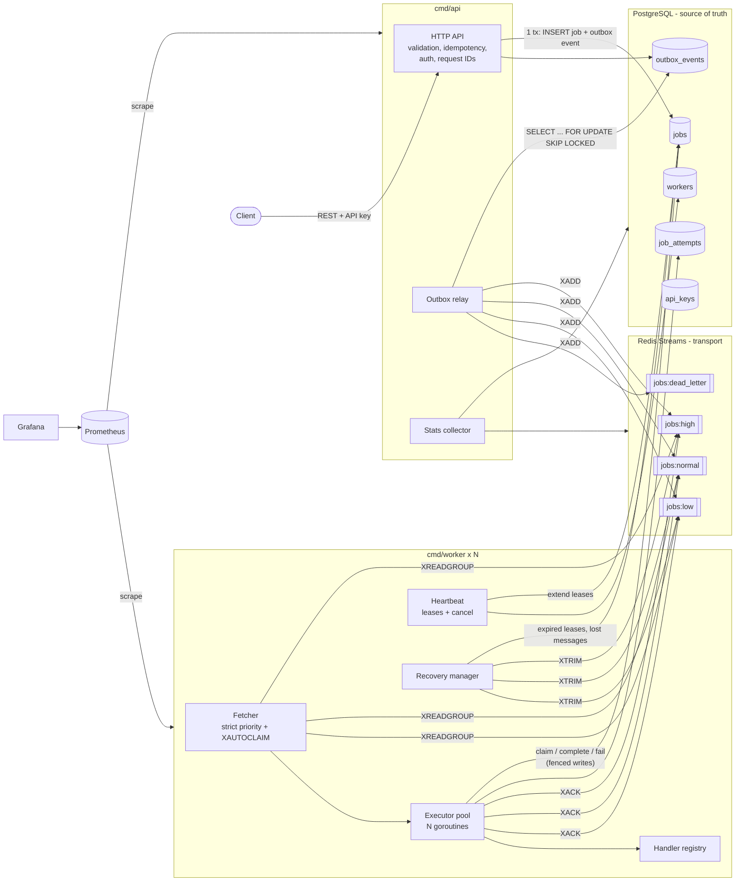
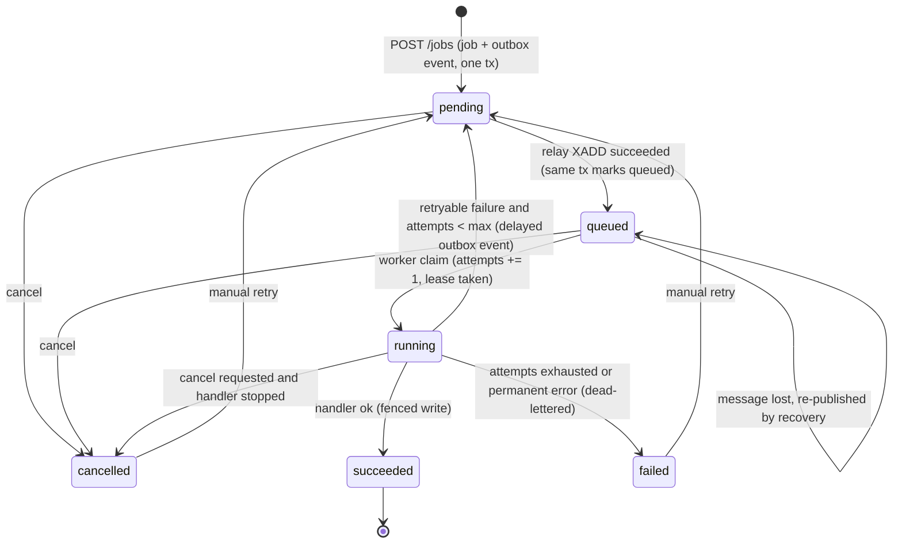
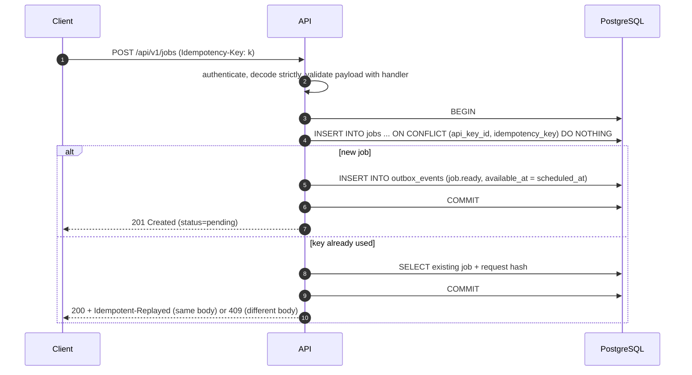

# EventFlow architecture

This document explains how EventFlow is put together, how a job moves through
the system, and why each design decision was made. The guiding rule is:

> **PostgreSQL is the source of truth. Redis only carries the hint "this job
> may be ready". Every state change is a conditional write in PostgreSQL.**

Everything else (at-least-once delivery, duplicate suppression, crash
recovery, cancellation) follows from that rule.

## Components



| Component | Package | Responsibility |
|-----------|---------|----------------|
| HTTP API | `internal/api`, `internal/middleware`, `internal/auth` | Validation, idempotency, auth, request IDs, structured logs, metrics |
| Job store | `internal/jobs` | Domain model, state machine, all SQL for job state transitions |
| Outbox | `internal/outbox` | Atomic event insertion; relay from PostgreSQL to Redis |
| Broker | `internal/broker` | Redis Streams: consumer groups, priority reads, claiming, trimming, stats |
| Worker engine | `internal/worker` | Concurrency, leases, heartbeats, cancellation, timeouts, graceful shutdown |
| Recovery manager | `internal/worker/recovery.go` | Expired leases, lost messages, dead workers, stream housekeeping |
| Handlers | `internal/jobs/handlers` | Five example job types (no external I/O) |
| Observability | `internal/observability` | JSON logging, Prometheus metrics |
| Migrations | `migrations`, `internal/database` | Versioned, embedded, reversible schema changes |

## Job lifecycle



The same table appears in code as `jobs.CanTransition` (unit-tested
exhaustively), and every SQL `UPDATE` in `internal/jobs/store.go` is written as
a compare-and-set against the expected current status.

## Data flow

### 1. Submission (transactional outbox)



The job row and the "publish me" intent commit atomically, so a crash can
never leave a persisted job that will not be published, or a published
message for a job that does not exist.

Delayed jobs and retries need no separate scheduler: they are outbox rows
whose `available_at` is in the future.

### 2. Relay (outbox → Redis)

```mermaid
sequenceDiagram
    autonumber
    participant R as Relay
    participant P as PostgreSQL
    participant S as Redis Stream
    participant W as Worker
    R->>P: BEGIN; SELECT due events JOIN jobs FOR UPDATE OF o, j SKIP LOCKED
    R->>S: XADD (pipelined batch)
    Note over W: A worker may receive the message now.<br/>Its claim blocks on the job row lock.
    R->>P: UPDATE outbox_events SET published; UPDATE jobs SET status = queued
    R->>P: COMMIT
    W->>P: (unblocked) sees status = queued, claims
```

* **Never marked published without a successful publication**: the
  `queued`/`published` updates only happen in the transaction that observed
  the XADD succeed. If XADD fails, the event's `attempts` and `last_error`
  are recorded and `available_at` is pushed back with capped exponential
  backoff.
* **Crash between XADD and COMMIT** means the event is published again later.
  That duplicate is harmless (see claim below).
* **Multiple relays** can run concurrently; `SKIP LOCKED` partitions the work.
* **Why lock the job row too?** In PostgreSQL's READ COMMITTED mode a
  conditional `UPDATE ... WHERE status = 'queued'` does *not* wait for a
  concurrent transaction if the row's snapshot version fails the predicate.
  Without the lock, a fast worker could see `pending`, drop the message, and
  strand the job. The integration tests caught exactly this race during
  development, and the fix is documented in `Store.Claim`.

### 3. Execution

```mermaid
sequenceDiagram
    autonumber
    participant W as Worker
    participant S as Redis
    participant P as PostgreSQL
    participant H as Handler
    W->>S: XREADGROUP high (non-blocking), then normal, then low; else BLOCK on all
    S-->>W: message {job_id}
    W->>P: BEGIN; SELECT status FOR UPDATE; UPDATE status=running,<br/>attempts+=1, worker_id, lease_expires_at; INSERT job_attempts; COMMIT
    alt job not queued (duplicate, stale, cancelled)
        W->>S: XACK (drop)
    else claimed
        par heartbeat every HEARTBEAT_INTERVAL
            W->>P: extend leases WHERE worker_id AND attempts match
            P-->>W: cancel_requested flags / missing = lease lost
        and execute
            W->>H: Handle(ctx with timeout, idempotency key = job id)
            H-->>W: result / error
        end
        W->>P: fenced UPDATE (succeeded | pending + retry event | failed + DLQ event | cancelled)
        W->>S: XACK (only after the outcome is durable)
    end
```

**Fencing.** Every write after the claim includes
`WHERE id = $1 AND status = 'running' AND worker_id = $2 AND attempts = $3`.
The attempt number acts as a fencing token. If the lease expired and the job
was handed to another worker, the stale worker's write matches zero rows and
returns `ErrLeaseLost`. At most one attempt can ever record success.

**Acknowledgement order.** The message is XACKed only after the outcome is
committed. If the worker crashes before XACK, the message stays in the
consumer group's Pending Entries List. Another worker re-claims it with
`XAUTOCLAIM`, the claim fails (the job is no longer `queued`), and the
message is acknowledged as a duplicate.

### 4. Retries and dead-lettering

A failed attempt is classified (`jobs.Classify`) using the handler error and
the context's cancellation cause:

| Class | Retryable | Source |
|-------|-----------|--------|
| `error` | yes | ordinary handler error |
| `timeout` | yes | attempt exceeded `timeout_seconds` |
| `panic` | yes | handler panicked (recovered by the registry) |
| `interrupted` | yes | worker shutdown grace period elapsed |
| `lease_expired` | yes | recovery found the worker dead mid-attempt |
| `lease_lost` | n/a | the lease was revoked; nothing is written |
| `permanent` | no | handler returned `jobs.Permanent(err)` (e.g. 4xx, bad input) |
| `unknown_type` | no | no handler registered |
| `cancelled` | no | client cancellation |

If retryable and `attempts < max_attempts`, the job returns to `pending` and,
**in the same transaction**, a `job.ready` outbox event is inserted with
`available_at = now + backoff(attempts)`. Backoff is capped exponential with
equal jitter: `delay = d/2 + rand(0, d/2)` where `d = min(max, base * 2^(n-1))`.
This guarantees spacing between attempts while spreading out retry storms.

Otherwise the job becomes `failed`, `dead_lettered_at` is set, and a
`job.dead_lettered` event is published to the `dead_letter` stream (again via
the outbox) with the error and attempt count. `POST /jobs/{id}/retry`
resurrects it with additional attempts, keeping the full attempt history.

### 5. Recovery manager

Runs in every worker process. All of its queries use `SKIP LOCKED` and
conditional updates, so concurrent instances cooperate safely.

| Failure | Detection | Repair |
|---------|-----------|--------|
| Worker crash / hang / partition during execution | `status = running AND lease_expires_at < now()` | Close attempt as `lost`, then retry with backoff or dead-letter (or finish the cancellation if one was requested) |
| Worker crash after delivery, before claim | message idle in PEL > `CLAIM_MIN_IDLE` | `XAUTOCLAIM` by a live worker, then normal processing |
| Worker crash after commit, before XACK | same | claim fails (not `queued`), message acked as duplicate |
| Redis lost data (restart without persistence, failover) | job `queued` longer than `STUCK_QUEUED_AFTER` **and** its stream has no undelivered/pending messages | Insert a fresh `job.ready` outbox event, which the relay re-publishes |
| Relay crash or Redis down | outbox events stay `pending` | Relay retries with backoff; the `outbox_backlog` metric and alert surface it |
| Dead worker registrations | heartbeat older than `WORKER_DEAD_AFTER` | Marked `dead` (informational; job safety relies on leases) |
| Unbounded stream growth | n/a | `XTRIM MINID` to the oldest entry still undelivered or unacknowledged |

The "stream drained" condition for re-publishing lost messages avoids
amplifying load when the queue is merely deep: a job can only be legitimately
`queued` without a message if Redis lost it.

### 6. Cancellation and the completion race

* `pending`/`queued`: cancelled immediately in one transaction, which also
  discards any unpublished `job.ready` events. Any message already in Redis
  becomes a no-op because the claim requires `queued`.
* `running`: `cancel_requested = true` (HTTP 202). The worker learns this from
  its next heartbeat and cancels the handler context with cause
  `ErrCancelRequested`. The handler's return is then recorded as `cancelled`.
* **Race**: if the handler finishes successfully before observing the
  cancellation, the job ends `succeeded`. Both outcomes are fenced writes on
  the same row, so exactly one wins and the job row and attempt history always
  agree. `TestConcurrentCancelAndCompletion` checks this over many races.

### 7. Graceful shutdown

On SIGTERM a worker stops fetching (an in-progress `XREADGROUP` is allowed to
finish so that delivered messages are never abandoned), marks itself
`stopping`, and waits up to `SHUTDOWN_TIMEOUT` for in-flight jobs. Jobs still
running after that are cancelled with cause `ErrWorkerShutdown`, recorded as
`interrupted`, and rescheduled. The worker then marks itself `stopped`. The
API marks itself not-ready (`/ready` → 503) before draining HTTP connections.

## Idempotency contract and the limits of exactly-once

EventFlow provides **at-least-once execution** and **exactly-once state
transitions**. It does **not** provide exactly-once side effects, and no
system that calls out to arbitrary external services can.

What is guaranteed:

* A submission with an idempotency key creates at most one job per API key
  (unique index; verified with 40 concurrent identical requests).
* A job's record transitions to `succeeded` at most once, by exactly one
  attempt (fencing). Duplicate messages never start a second concurrent
  execution of the same job: claims are serialised by the row lock and
  require `queued`.
* A handler is re-run only if the previous attempt's outcome was not durably
  recorded (crash, lease expiry, shutdown interruption).

What a handler must do:

* Treat `Execution.IdempotencyKey` (the job ID, stable across attempts) as
  the deduplication key for any external side effect. Examples: send it as
  the `Idempotency-Key` header to payment or webhook APIs, use it as an email
  provider's message ID (the simulated email handler does this), or write
  results with `INSERT ... ON CONFLICT (job_id) DO NOTHING`.
* Honour context cancellation promptly, so that lease loss, timeouts,
  cancellation and shutdown stop work early. Workers also fence themselves:
  if heartbeats fail for longer than a lease period they cancel their own
  handlers, which narrows the window in which two workers could run the same
  job.

Where it still breaks down: a handler that performs a non-idempotent external
call and then crashes before the outcome is recorded will repeat that call on
retry. Only the downstream system can deduplicate that, using the key.

## Database design

```mermaid
erDiagram
    api_keys ||--o{ jobs : submits
    jobs ||--o{ job_attempts : "execution history"
    jobs ||--o{ outbox_events : announces
    workers ||..o{ jobs : "worker_id (soft reference)"

    api_keys { bigint id PK; text name UK; bytea key_hash UK "SHA-256"; timestamptz revoked_at }
    jobs {
        uuid id PK "UUIDv7"
        text type
        text queue "high|normal|low"
        jsonb payload
        smallint priority "1-10"
        text status
        bigint api_key_id FK
        text idempotency_key "UK with api_key_id"
        bytea request_hash
        int attempts
        int max_attempts
        int timeout_seconds
        timestamptz scheduled_at
        timestamptz queued_at
        timestamptz started_at
        timestamptz completed_at
        text worker_id
        timestamptz lease_expires_at
        bool cancel_requested
        text last_error
        text last_error_class
        jsonb result
        bigint duration_ms
        timestamptz dead_lettered_at
        bigint version
    }
    job_attempts { bigint id PK; uuid job_id FK; int attempt_number "UK with job_id"; text worker_id; text status; timestamptz started_at; timestamptz finished_at; bigint duration_ms; text error; text error_class }
    outbox_events { bigint id PK; uuid job_id FK; text event_type; text queue; jsonb payload; text status; int attempts; text last_error; timestamptz available_at; timestamptz published_at; text stream_message_id }
    workers { text id PK; text hostname; int pid; int concurrency; text status; timestamptz last_heartbeat_at }
```

Key indexes (all chosen for specific queries):

| Index | Serves |
|-------|--------|
| `jobs_idempotency_uniq (api_key_id, idempotency_key) WHERE key IS NOT NULL` | Idempotency (partial unique) |
| `jobs_created_idx (created_at DESC, id DESC)` | Keyset pagination |
| `jobs_status_created_idx`, `jobs_type_created_idx` | Filtered listing |
| `jobs_running_lease_idx (lease_expires_at) WHERE status='running'` | Lease recovery scan |
| `jobs_queued_idx (queue, queued_at) WHERE status='queued'` | Lost-message scan |
| `outbox_pending_idx (available_at, id) WHERE status='pending'` | Relay poll (stays tiny) |

Integrity is also enforced by CHECK constraints: valid statuses and queues,
`attempts <= max_attempts`, and "a running job must have a worker and a lease".

**Concurrency control.** Correctness relies on row-level compare-and-set
(status + fencing token) rather than on `version`. `version` increments on
every transition and is exposed to clients for change detection and
optimistic UI updates.

**Migrations** are embedded in the binaries, applied under a PostgreSQL
advisory lock (safe with several replicas starting together), each in its
own transaction together with its bookkeeping row. Every migration has a
down file. `migrate down N` rolls back, and the integration suite checks
up → down → up. For production, prefer forward fixes and expand/contract
migrations, and keep down files for development and emergency rollback.

**Least privilege.** `deploy/postgres/init-roles.sh` creates
`eventflow_app` with DML-only rights. Migrations run as the schema owner, and
the runtime role cannot run DDL or modify `schema_migrations` (verified
against the Compose stack).

## Redis Streams design

* One stream per priority band: `eventflow:jobs:{high,normal,low}`, plus
  `eventflow:jobs:dead_letter` (published, not consumed by workers).
* One consumer group (`eventflow-workers`) shared by all workers. Each worker
  process is a consumer named by its worker ID.
* **Strict priority**: each fetch probes `high`, then `normal`, then `low`
  without blocking, and only blocks (for `BLOCK_TIMEOUT`) on all three when
  every queue is empty. Low-priority work can starve under sustained
  high-priority load. That is the documented trade-off; weighted fair
  scheduling is listed under future work.
* **Back-pressure**: a worker only reads as many messages as it has free
  execution slots, so messages never pile up idle in a busy consumer's PEL.
* **Trimming**: `XTRIM MINID` to the oldest ID that is still undelivered or
  pending, so trimming never removes a message that still has to be processed
  (tested).
* **Persistence**: Compose runs Redis with AOF (`appendfsync everysec`). Even
  without it, recovery re-publishes lost messages from PostgreSQL.

## Observability

* **Logs**: JSON via `log/slog`, one access-log line per request
  (`request_id`, route pattern, status, duration), plus job lifecycle events
  carrying `job_id`, `job_type`, `attempt`, `worker_id`. API keys, payloads and
  connection strings are never logged.
* **Metrics**: see the table in the README. Label values are bounded (job
  types from the registry, fixed queue and class enums, route *patterns*).
  Job IDs are never labels.
* **System gauges** (queue depth, jobs by state, outbox backlog, active
  workers) are exported only by the API process, so they are not double
  counted across worker replicas.
* **Dashboard**: `monitoring/grafana/dashboards/eventflow.json`, generated by
  `scripts/gen_dashboard.py`. **Alerts**: `monitoring/prometheus/alerts.yml`.

## Design decisions (and alternatives considered)

| Decision | Why | Alternative |
|----------|-----|-------------|
| PostgreSQL as source of truth, Redis as transport | Durable, queryable state with transactional guarantees; Redis gives low-latency fan-out and consumer groups | Redis-only (state lost on failover) or PostgreSQL-only queue with `SKIP LOCKED` (simpler, but polling load and no stream semantics) |
| Transactional outbox | Atomic "persist + publish" without two-phase commit | Dual write (inconsistent on crash), CDC/Debezium (heavier infrastructure) |
| Outbox doubles as scheduler | Delayed jobs and retries are just future `available_at` rows | Separate scheduler process or Redis sorted sets |
| Lock-then-check claim | Correct under READ COMMITTED when racing the relay | Plain conditional UPDATE (loses messages; caught by tests) |
| Attempt number as fencing token | Simple, monotonic, already needed for history | Separate lease token column |
| Lease + heartbeat + recovery | Handles crashes, hangs and partitions uniformly | Rely only on Redis PEL (cannot detect hung handlers; state lives in DB) |
| Ack after durable outcome | Never lose a job | Ack on receipt (loses jobs on crash) |
| Priority bands as separate streams | Streams are FIFO; separate streams give real priority | Single stream (no priority) or sorted sets (no consumer groups) |
| UUIDv7 job IDs | Time-ordered: index-friendly inserts and natural ordering | UUIDv4 (random index writes), bigserial (enumerable) |
| Hashed API keys in DB, bootstrapped from env | Keys never stored in plaintext; revocable | Plain env comparison only (no revocation, no attribution) |
| stdlib `net/http` routing (Go 1.22 patterns) | Fewer dependencies; route pattern available for metrics | chi/gin |
